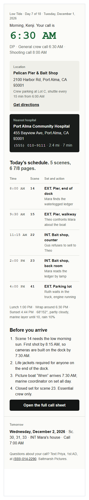
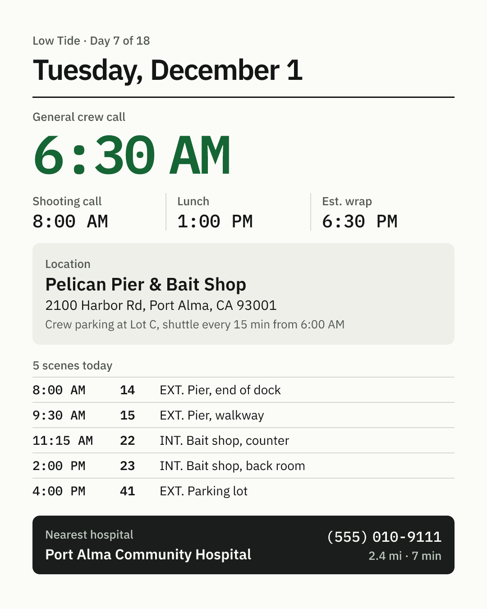

# Call Sheet Kit

One typed object for a film shoot day, three outputs from the same design system:

- **A print call sheet** (Letter PDF), the page the 2nd AD hands out every night
- **The morning email**, one copy per crew member with their own call time at the top
- **A group-chat card** (1080 × 1350 PNG and SVG) people can read without opening it

All three are built with [Hyper Elements](https://hyperelements.dev) (`@hyper-elements/react`). Nothing is written twice: change a time in `src/data.ts` and the PDF, the 15 emails and the card all change with it.

| Print PDF | Email, classic Outlook | Email, Gmail app | Group-chat card |
|---|---|---|---|
|  |  |  |  |

The email screenshots come from Hyper Elements' email-client emulator (`@hyper-elements/email-clients`), not a browser.

## Why a call sheet

Every shoot day a 2nd AD rebuilds the same information three times: a PDF for the printer, an email for the crew, and a screenshot for the WhatsApp group. The three drift apart, and someone turns up at the wrong time. Here the day is one `CallSheet` object, and each output is a template that reads it.

## How Hyper Elements is used

| Feature | Where | What it does here |
|---|---|---|
| `defineTheme` + `Register` + `formats` | `src/theme.ts` | One typed theme for all three roots (`document`, `email`, `canvas`): colours, fonts, per-format type/spacing/radius scales, button hover state, and named styles (`card`, `invertCard`, `label`, `figure`, `muted`) |
| Scoped `tokens` | `src/pdf.tsx`, `src/email.tsx`, `src/card.tsx` | Overrides `background`, `foreground`, and `muted` on the inverted hospital container instead of threading separate colour overrides into every child |
| `defineElement` | `src/elements.tsx` | Two custom elements with typed props: `StatBlock` (shared by both the PDF and the card, scaling automatically via theme `formats`) and `DeptBlock` (a department's crew and calls) |
| `Document` + `renderPdf` | `src/pdf.tsx`, `scripts/render-pdf.tsx` | The Letter PDF (`lang="en"`, web fonts for `call-sheet.print.html`, embedded TTF bytes for the PDF), with `Table`, `Grid`, `List`, `PageFooter` and `PageNumber` |
| `Email` + `MergeTag` | `src/email.tsx` | A 600px email. `crew_name`, `crew_role`, `call_time` and `crew_note` render as `{{merge_tags}}` for any sending service |
| `render` + `emailClients()` | `scripts/render-email.tsx` | Checks the email against 11 clients in one pass while rendering HTML and plain text |
| `renderInEmailClients` + `mergeTag` | `scripts/render-email.tsx --preview` | Previews the `<Email>` directly in classic Outlook, Outlook.com, Gmail, the Gmail app and Apple Mail (including Apple Mail's dark preview; the sheet intentionally stays ivory-toned) |
| `Canvas` + `fit` + `layoutImage` + `renderImage` | `src/card.tsx`, `scripts/render-card.tsx` | The 1080 × 1350 group-chat card as PNG and SVG, with auto-fitting headings (`fit`) and strict layout/glyph validation (`layoutImage`) |

### One email, fifteen recipients

The email is rendered once. `render()` writes each `MergeTag` in `{{name}}` syntax, so the same HTML drops into Mailchimp, Postmark or SendGrid. For a local test, the script fills the tags (with HTML escaping) for every department crew member in `departments[].crew` — 15 emails, including per-person notes like Eli Brooks's prop note via `{{crew_note}}` (cast calls live in the PDF) — and writes `out/email/crew/<name>.html`:

```tsx
<Text>
  Morning, <MergeTag name="crew_name" />. Your call is
</Text>
<Text style={{ apply: ["figure"], fontSize: 48, color: token("colors.accent") }}>
  <MergeTag name="call_time" />
</Text>
```

### What the client checks found

`render(email, { plugins: [await emailClients()] })` finds no errors or warnings. Its info notes report that classic Outlook draws square corners, draws weight 500 as regular, skips letter spacing, and ignores button hover states (as do Outlook.com and Outlook for Mac); `gmail-app-other` keeps desktop styles on phones (though `Row`s still stack); and web fonts load in Apple Mail while falling back to Arial and Courier New elsewhere. The design was built so none of those lose hierarchy: emphasis comes from 600 weight and size, not corners or tracking.

Fixes made after reading the previews:

- Scene descriptions moved to their own line, so table rows keep one height in Outlook
- The Scene column widened after its header wrapped on a 345px phone
- Non-breaking spaces between numbers, units and fractions (`6:30 AM`, `1 2/8`, `6 7/8`) so they never split across lines

## Design

- **Palette:** warm ivory paper (`#FBFBF8`), deep charcoal ink (`#141615`), one muted mineral grey (`#525852`), pale mineral cards (`#EFEFE9`). Dark pine (`#166534`) is used once for the call time (general crew call on the PDF and card; each recipient's personal call time in the email). Hospital details invert to deep charcoal (`#1A1D1B`) via scoped theme tokens instead of adding a second colour.
- **Type:** IBM Plex Sans for text, IBM Plex Mono for every time, so columns of times line up.
- **Rules:** sentence case labels, no tracked capitals, no coloured status chips, one card radius token per format (`6px` in PDF/email, `16px` on the card), two boxes deep at most.

## Run it

Requires Node 20 or later.

```bash
git clone https://github.com/cipoklean/call-sheet-kit.git
cd call-sheet-kit
npm install

npm run render          # PDF, email and card into out/
npm run preview:email   # also writes email-client previews to out/email/previews/
```

| Command | Writes |
|---|---|
| `npm run render:pdf` | `out/call-sheet.pdf`, `out/call-sheet.print.html` |
| `npm run render:email` | `out/email/call-sheet.email.html` (with merge tags), `.txt`, and `out/email/crew/*.html` |
| `npm run preview:email` | The above, plus one HTML preview per client in `out/email/previews/` (gitignored until you run this command; open them in Chrome or Chromium) |
| `npm run render:card` | `out/call-sheet-card.png`, `out/call-sheet-card.svg` |

Add `--outline` to the PDF script to print the laid-out tree: `npx tsx scripts/render-pdf.tsx --outline`.

## Make it yours

Edit `src/data.ts` (including `sheetUrl` for the email button, optional `episode`, `weather.summary`, and crew `note`/`phone` fields). It's typed against `src/types.ts`, so a missing call time or a scene with an unknown `dayNight` value fails at compile time (`npm run typecheck`).

## Project layout

```
src/
  types.ts      the CallSheet type
  data.ts       one fictional shoot day ("Low Tide", day 7 of 18)
  fonts.ts      typed web-font faces shared by Document and Email
  theme.ts      the shared theme (with Register + document/email/canvas formats)
  elements.tsx  StatBlock and DeptBlock custom elements
  pdf.tsx       Document root
  email.tsx     Email root
  card.tsx      Canvas root
scripts/        one render script per output
fonts/          IBM Plex Sans and Mono (SIL OFL 1.1)
out/            rendered outputs, committed so you can look without installing
docs/           README screenshots
```

## Licence

Code: MIT. Fonts: IBM Plex, SIL Open Font License 1.1. The production, people and places in `src/data.ts` are fictional.
