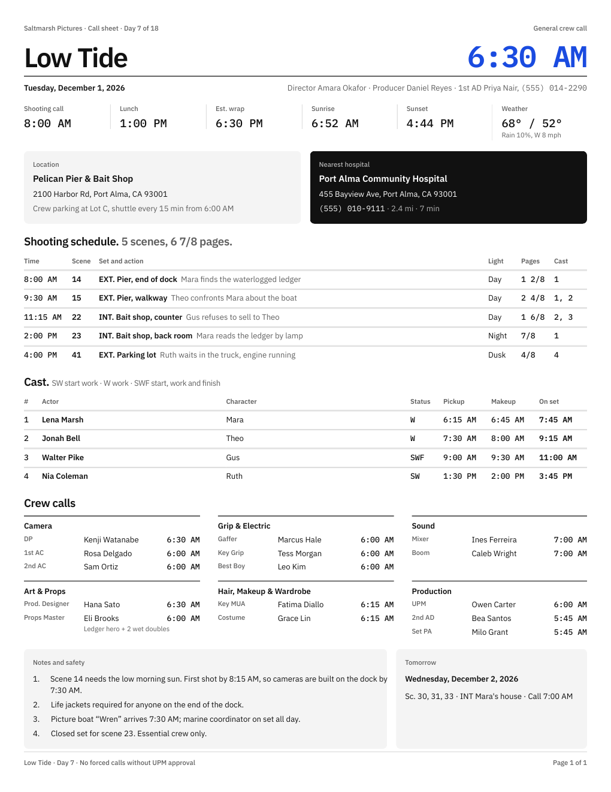
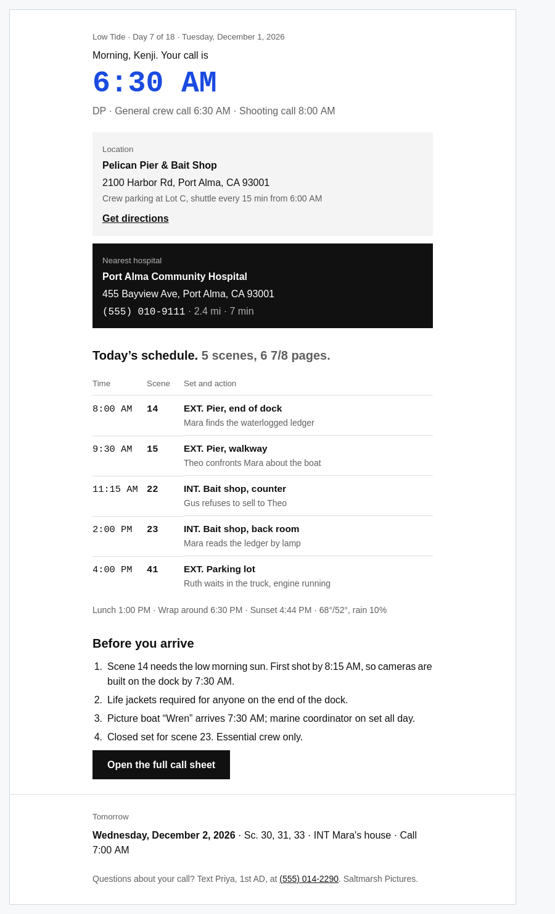

# Call Sheet Kit

One typed object for a film shoot day, three outputs from the same design system:

- **A print call sheet** (Letter PDF), the page the 2nd AD hands out every night
- **The morning email**, one copy per crew member with their own call time at the top
- **A group-chat card** (1080 × 1350 PNG and SVG) people can read without opening it

All three are built with [Hyper Elements](https://hyperelements.dev) (`@hyper-elements/react`). Nothing is written twice: change a time in `src/data.ts` and the PDF, the 15 emails and the card all change with it.

| Print PDF | Email, classic Outlook | Email, Gmail app | Group-chat card |
|---|---|---|---|
|  |  |  |  |

The email screenshots come from Hyper Elements' email-client emulator (`@hyper-elements/email-clients`), not a browser.

## Why a call sheet

Every shoot day a 2nd AD rebuilds the same information three times: a PDF for the printer, an email for the crew, and a screenshot for the WhatsApp group. The three drift apart, and someone turns up at the wrong time. Here the day is one `CallSheet` object, and each output is a template that reads it.

## How Hyper Elements is used

| Feature | Where | What it does here |
|---|---|---|
| `defineTheme` | `src/theme.ts` | One theme for all three roots: colours, fonts, the heading scale, the one card style |
| `defineElement` | `src/elements.tsx` | Two custom elements, `StatBlock` (a label over a figure) and `DeptBlock` (a department's crew and calls), with typed props |
| `Document` + `renderPdf` | `src/pdf.tsx`, `scripts/render-pdf.tsx` | The Letter PDF, with `Table`, `Grid`, `List`, `PageFooter` and `PageNumber`. Fonts go in as bytes, no browser needed |
| `Email` + `MergeTag` | `src/email.tsx` | A 600px email. `crew_name`, `crew_role` and `call_time` render as `{{merge_tags}}` for any sending service |
| `validate` + `emailClients()` | `scripts/render-email.tsx` | Checks the email against 11 clients before it's written |
| `renderInEmailClients` | `scripts/render-email.tsx --preview` | Previews in classic Outlook, Outlook.com, Gmail, the Gmail app and Apple Mail (light and dark) |
| `Canvas` + `renderImage` | `src/card.tsx`, `scripts/render-card.tsx` | The group-chat card as PNG and SVG |

### One email, fifteen recipients

The email is rendered once. `render()` writes each `MergeTag` in `{{name}}` syntax, so the same HTML drops into Mailchimp, Postmark or SendGrid. For a local test, the script fills the tags for every crew member and writes `out/email/crew/<name>.html`:

```tsx
<Text style={{ fontSize: 16 }}>
  Morning, <MergeTag name="crew_name" />. Your call is
</Text>
<Text style={{ fontSize: 48, color: token("colors.accent") }}>
  <MergeTag name="call_time" />
</Text>
```

### What the client checks found

`validate(email, { plugins: [await emailClients()] })` finds no errors. Its notes say classic Outlook draws square corners, draws weight 500 as regular, and skips letter spacing. The design was built so that loses nothing: emphasis comes from 600 weight and size, not from corners or tracking. Web fonts load in Apple Mail and fall back to Arial and Courier New elsewhere.

Fixes made after reading the previews:

- Scene descriptions moved to their own line, so table rows keep one height in Outlook
- The Scene column widened after its header wrapped on a 345px phone
- Non-breaking spaces between numbers and units (`6:30 AM`, `6 7/8`) so they never split across lines

## Design

- **Palette:** white paper, black type, one grey, one pale grey for cards. Biro blue is used once, for the general crew call. Hospital details are inverted to black instead of adding a second colour.
- **Type:** IBM Plex Sans for text, IBM Plex Mono for every time, so columns of times line up.
- **Rules:** sentence case labels, no tracked capitals, no coloured status chips, one radius, two boxes deep at most.

## Run it

Requires Node 20 or later.

```bash
git clone https://github.com/cipoklean/call-sheet-kit.git
cd call-sheet-kit
npm install

npm run render          # PDF, email and card into out/
npm run preview:email   # also writes email-client previews to out/email/previews/
```

| Command | Writes |
|---|---|
| `npm run render:pdf` | `out/call-sheet.pdf`, `out/call-sheet.print.html` |
| `npm run render:email` | `out/email/call-sheet.email.html` (with merge tags), `.txt`, and `out/email/crew/*.html` |
| `npm run preview:email` | The above, plus one HTML preview per client. Open them in Chrome or Chromium |
| `npm run render:card` | `out/call-sheet-card.png`, `out/call-sheet-card.svg` |

Add `--outline` to the PDF script to print the laid-out tree: `npx tsx scripts/render-pdf.tsx --outline`.

## Make it yours

Edit `src/data.ts`. It's typed against `src/types.ts`, so a missing call time or a scene with an unknown `dayNight` value fails at compile time (`npm run typecheck`).

## Project layout

```
src/
  types.ts      the CallSheet type
  data.ts       one fictional shoot day ("Low Tide", day 7 of 18)
  theme.ts      the shared theme
  elements.tsx  StatBlock and DeptBlock custom elements
  pdf.tsx       Document root
  email.tsx     Email root
  card.tsx      Canvas root
scripts/        one render script per output
fonts/          IBM Plex Sans and Mono (SIL OFL 1.1)
out/            rendered outputs, committed so you can look without installing
docs/           README screenshots
```

## Licence

Code: MIT. Fonts: IBM Plex, SIL Open Font License 1.1. The production, people and places in `src/data.ts` are fictional.
